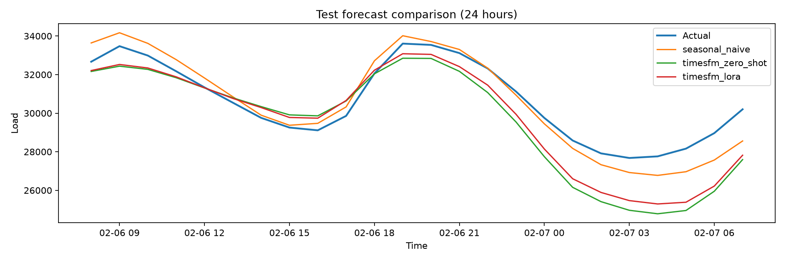

# PJME Electricity Demand Forecasting with TimesFM

A research project testing whether LoRA fine-tuning of a pretrained time-series model improves 24-hour-ahead forecasts of PJME hourly electricity demand.

> **Status:** CPU fine-tuning is complete and a 90-window held-out comparison is committed. On that sample, the LoRA adapter lowered MAE by 6.9% versus zero-shot TimesFM. This is a preliminary sampled result, not a full-test-period conclusion. Training and evaluation also used slightly different gap-filling rules; see [Results and limitations](docs/results-and-limitations.md).

## Research question

Does adapting TimesFM 2.5 to PJME improve forecasts over the pretrained model and a weekly seasonal-naive baseline?

## Latest held-out sample

All three models were evaluated on the same 90 evenly sampled, non-overlapping forecast days (2,160 hours) from the chronological test partition.

| Model | MAE | RMSE | MASE | MAE skill vs weekly naive |
| --- | ---: | ---: | ---: | ---: |
| Weekly seasonal naive | 3,219.16 | 4,566.66 | 1.497 | 0.0% |
| TimesFM 2.5 zero-shot | 1,594.68 | 2,227.03 | 0.742 | 50.5% |
| TimesFM 2.5 LoRA (epoch 2) | **1,485.24** | **2,053.16** | **0.691** | **53.9%** |

On these sampled windows, LoRA lowered MAE by 6.9% versus zero-shot TimesFM. It had lower MAE on 55 of 90 forecast days and lower aggregate MAE on 20 of 24 lead hours. No confidence interval or significance test has been calculated; the result may not generalize to every test day.



## What is complete

- Hourly data loading, chronological splits, forecast models, and MAE/RMSE/MASE evaluation.
- Unit tests and GitHub Actions for the lightweight test suite.
- Five LoRA training epochs on PJME, run on CPU after the MSI AMD GPU path proved incompatible with the required TimesFM stack.
- A shared-origin comparison of weekly seasonal naive, zero-shot TimesFM, and the LoRA adapter.
- Committed adapter weights, aggregate metrics, per-lead-hour metrics, plot, and experiment notes.

Epoch 2 was selected by validation loss (0.272994). The run used 512 hours of context, a 24-hour horizon, 2,000 sampled windows per epoch, batch size 8, and LoRA rank 4 / alpha 8. Four timed resumed epochs took about 41.7 minutes. See the [experiment log](docs/experiment-log.md) and [adapter notes](outputs/timesfm-lora-cpu/README.md).

## Quick start

This smoke test uses synthetic data and the seasonal-naive baseline; it does not reproduce the PJME result.


```bash
python -m venv .venv
source .venv/bin/activate
pip install -r requirements.txt
python scripts/make_demo_data.py
python -m src.run_experiment --data data/demo_hourly.csv --model seasonal_naive
```

## Reproduce the committed sample

Use the normalized PJME CSV at `data/pjme_hourly.csv` and install fine-tuning dependencies. Download/cache the TimesFM checkpoint if needed, then run:

```bash
pip install -r requirements-finetune.txt
python scripts/compare_models.py \
  --data data/pjme_hourly.csv \
  --adapter outputs/timesfm-lora-causal \
  --split test \
  --windows 90 \
  --inference-batch-size 8
```

The corrected causal-forward-fill retrain is in `outputs/timesfm-lora-causal`; its matched 90-window report is in `outputs/model-comparison-causal`. The earlier adapter and report are retained for comparison. See [the experiment log](docs/experiment-log.md) for training history and benchmark limitations.

The real PJME CSV and row-level predictions are not committed. See [Project guide](docs/project-guide.md) for the repository map and workflow, and [Results and limitations](docs/results-and-limitations.md) for metric definitions, caveats, and next steps.

## Scope

This is a learning and evaluation prototype, not a production forecasting service. It does not establish reliable gains across every test day, other regions, or future operating conditions.
