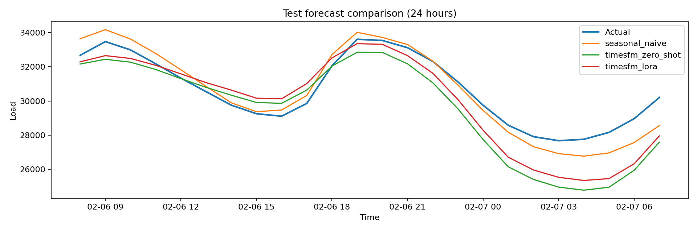

# Full PJME test comparison (Kaggle T4)

All three methods were evaluated on the same 908 daily origins (21,792 hourly predictions) in the chronological PJME test partition. Training and evaluation used the repository's causal forward-fill preprocessing. The fine-tuned adapter was selected by validation loss (epoch 1 of 5; validation loss 0.273837).

| Model | MAE | RMSE | MASE | MAE skill vs seasonal naive |
| --- | ---: | ---: | ---: | ---: |
| Weekly seasonal naive | 3432.2825 | 4733.9480 | 1.596026 | 0.0% |
| TimesFM 2.5 zero-shot | 1582.7728 | 2214.4242 | 0.735996 | 53.9% |
| TimesFM 2.5 LoRA | 1536.4459 | 2132.7119 | 0.714454 | 55.24% |

The LoRA model reduced MAE by 2.9% against zero-shot TimesFM on this holdout. These are aggregate metrics for one PJME series and one chronological test interval. No confidence interval or significance test was calculated.

The run used an NVIDIA Tesla T4, FP16, context length 512, horizon 24, 2,000 sampled training windows per epoch, batch size 8, and inference batch size 32. The adapter, aggregate metrics, per-lead metrics, and plot are committed. Row-level predictions are excluded from Git.

