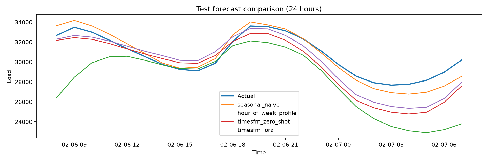

# Full PJME test comparison (Kaggle T4)

All four methods were evaluated on the same 908 daily origins (21,792 hourly predictions) in the chronological PJME test partition. Training and evaluation used the repository's causal forward-fill preprocessing. The fine-tuned adapter was selected by validation loss (epoch 1 of 5; validation loss 0.273837).

| Model | MAE | RMSE | MASE | MAE skill vs weekly seasonal naive |
| --- | ---: | ---: | ---: | ---: |
| Weekly seasonal naive | 3432.2825 | 4733.9480 | 1.596026 | 0.0% |
| Hour-of-week profile, recent-level adjusted | 2771.7497 | 3898.7258 | 1.288876 | 19.2% |
| TimesFM 2.5 zero-shot | 1582.7728 | 2214.4242 | 0.735996 | 53.9% |
| TimesFM 2.5 LoRA | 1536.4459 | 2132.7119 | 0.714454 | 55.24% |

The LoRA model reduced MAE by 2.93% against zero-shot TimesFM on this holdout. A paired seven-day moving-block bootstrap (2,000 resamples) estimated a 95% interval of 0.64% to 5.11% for the MAE reduction. The LoRA model had lower MAE than zero-shot TimesFM in 8 of 11 calendar quarters; it was worse in three quarters. The quarterly rows are slices of the same 2016–2018 test partition, not independent test sets.

The run used an NVIDIA Tesla T4, FP16, context length 512, horizon 24, 2,000 sampled training windows per epoch, batch size 8, and inference batch size 32. The adapter, aggregate metrics, per-lead metrics, quarter-level metrics, paired block-bootstrap intervals, plot, and row-level predictions are committed. `predictions.csv` contains one row per forecasted hour and model, with the forecast origin, timestamp, lead hour, actual value, and forecast value.

The **hour-of-week profile** baseline fits the median training load for each hour of the week, then adjusts that profile by the median ratio from the most recent context week. This provides an interpretable statistical comparator alongside weekly seasonal naive. The uncertainty intervals resample contiguous seven-day blocks of paired daily-origin errors to account for dependence between adjacent forecast days. The intervals describe this holdout and are not a guarantee of future performance.

See [`period_metrics.csv`](period_metrics.csv) for quarterly MAE/RMSE/MASE, [`uncertainty.json`](uncertainty.json) for paired bootstrap results, and [`analysis_manifest.json`](analysis_manifest.json) for the provenance of the saved-prediction analysis. It records that this post-hoc analysis did not rerun TimesFM inference and hashes its source predictions. New full comparison runs also write `run_manifest.json` with inference-run provenance. Use `--windows 0` to evaluate every daily origin and compute block-bootstrap intervals.

